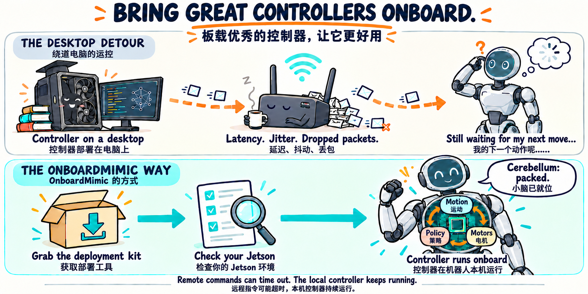
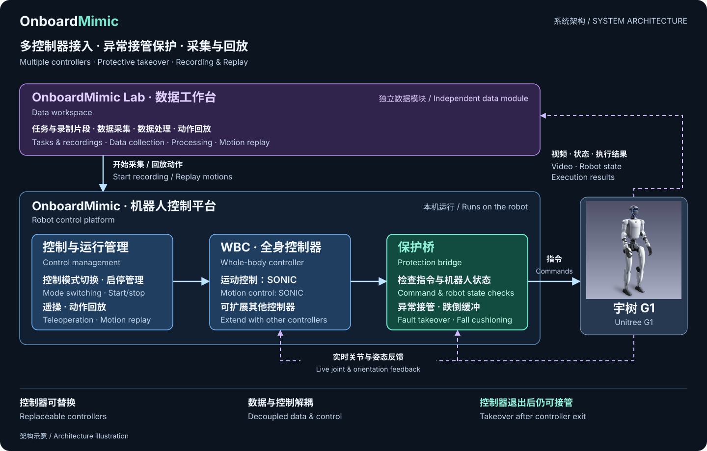
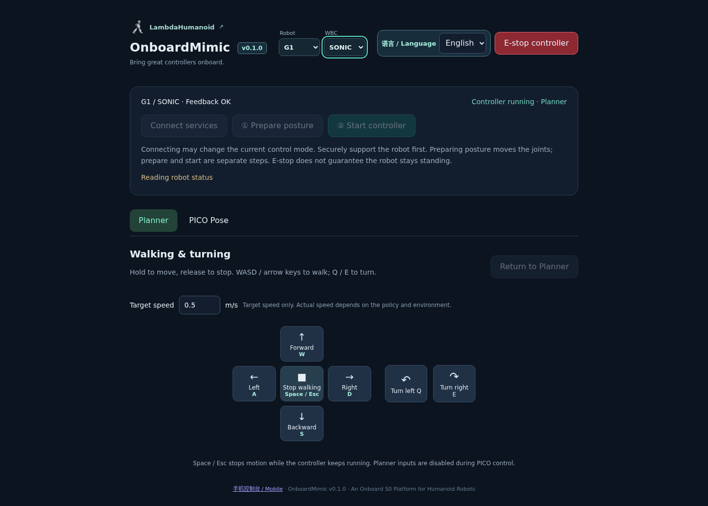
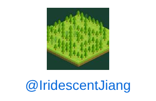
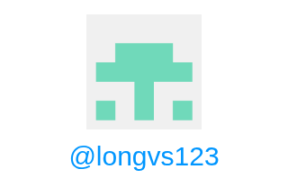

# OnboardMimic

**Bring great controllers onboard.** · **板载优秀的控制器，让它更好用**

**An Onboard S0 Platform for Humanoid Robots / 人形机器人的板载 S0 平台**

> 🚀 **SONIC onboard today. SuperMimic is next on our roadmap.**
>
> **SONIC 已实现板载部署，下一站计划接入 SuperMimic。**

SONIC is our first onboard controller. Run it on your G1’s own Jetson: keep the robot’s cerebellum onboard, with JetPack 5/6 deployment tools, bilingual desktop/mobile consoles and PICO full-body teleoperation.

> SONIC 是首个板载控制器，目前支持 **Unitree G1**：让机器人的“小脑”运行在自身 Jetson 上，配套 JetPack 5/6 部署工具、中英文电脑/手机控制台与 PICO 全身遥操。

https://github.com/user-attachments/assets/6afc6f3e-d37e-4cd0-8d34-da85d1bc39bf

[📚 Documentation / 文档](docs/README.md) · [🚀 Get started](#get-started) · [📦 Download v0.2.0](https://github.com/LambdaHumanoid/OnboardMimic/releases/tag/v0.2.0) · [🤝 Community](#community) · [🧪 Lab](#lab) · [🎮 Console](#consoles) · [🧩 Architecture](docs/ARCHITECTURE.md)

OM and Lab share the root [`VERSION`](VERSION). Use the v0.2.0 package for your JetPack version and follow the [documentation index](docs/README.md).

> OM 与 Lab 统一使用根目录 `VERSION`。请按 JetPack 版本选择 v0.2.0 安装包，操作指南见[文档索引](docs/README.md)。

## 📰 News

<a id="v020"></a>

- **[v0.2.0](https://github.com/LambdaHumanoid/OnboardMimic/releases/tag/v0.2.0) · Record, replay and protect.** Integrated [OnboardMimic Lab](#lab) with LeRobot v2.1 recording and replay, [fall protection](docs/WBC_PROTECTION.rst) on unexpected controller stops, and separate JP5/JP6 runtime packages.

> **v0.2.0 · 数采、回放与保护。** 集成 OnboardMimic Lab，支持 LeRobot v2.1 数采与回放，新增控制器异常停止时的摔倒保护，提供独立的 JP5、JP6 运行包。

- **[v0.1.1](https://github.com/LambdaHumanoid/OnboardMimic/releases/tag/v0.1.1) · Easier JP5 installation.** Automatic TensorRT dependency installation, broader JP5 compatibility, and improved controller detection.

> **v0.1.1 · JP5 安装更省心。** 自动补装 TensorRT 依赖，放宽 JP5 兼容检测，完善控制进程识别。

- **v0.1.0 · First aboard: SONIC.** [Prebuilt packages](https://github.com/LambdaHumanoid/OnboardMimic/releases/tag/v0.1.0) for G1 / JetPack 5, with bilingual desktop/mobile consoles for **Planner walking** and optional **PICO Pose** teleoperation. [Setup and controls](docs/CONTROL_EXTENSIONS.md).

> **v0.1.0 · 首个板载控制器：SONIC。** 提供面向 G1 / JP5 的预编译安装包，配套中英文电脑和手机控制台，支持 **Planner 行走**与可选 **PICO Pose 全身遥操**。[安装与控制说明](docs/CONTROL_EXTENSIONS_zh.md)。

## 📝 TODO

- [ ] **Integrate SuperMimic as an onboard backend. / 接入 SuperMimic 板载后端。**
- [x] Integrate recording and replay tooling in Lab. / 内置 Lab 数采与回放工具。
- [ ] Adapt SONIC’s low-latency and newer policy variants. / 适配 SONIC 的低延迟版本和更新策略。
- [ ] Bring more controllers and robot bodies onboard. / 适配更多控制器与机器人本体。

## 📡 Let your Wi-Fi take a coffee break

**Onboard deployment. Easier to use. Starting with SONIC.** OnboardMimic keeps the motion-control loop off Wi-Fi. We’re starting with SONIC on G1: adapting its planner and policy to the robot’s existing JetPack 5 system and bringing deployment tools, runtime management and control interfaces together. Your laptop gets to be a remote control. Your robot gets to do its own balancing.

Why does this matter? Official SONIC supports onboard deployment, but its [G1 Orin setup](https://nvlabs.github.io/GR00T-WholeBodyControl/getting_started/installation_deploy.html) requires **JetPack 6 and TensorRT 10.7**. For a G1 still on JP5, the [flashing guide](https://nvlabs.github.io/GR00T-WholeBodyControl/references/jetpack6.html) involves removing the back cover and NVMe SSD, flashing the system and module firmware, then reassembling the robot. You wanted to install software; now there is a screwdriver on the desk.

Running SONIC on an external GPU computer avoids that onboard setup, but puts network latency, jitter and dropped packets in the control path. Your robot has acquired a wireless leash.

With OnboardMimic’s SONIC backend, the control loop stays on the robot’s Jetson, using the supported JP5 or JP6 installation path below. The laptop or phone sends commands; PICO sends body tracking. Remote commands and tracking still need a network, but the local motion-control loop no longer takes the round trip.

> **实现板载部署，更好用。先从 SONIC 开始。** OnboardMimic 将运控闭环留在机器人本机，不再绕经 Wi-Fi。我们先将 SONIC 的规划器和策略适配到 G1 现有的 JetPack 5 系统，并提供配套部署工具、运行管理和操控界面。电脑负责遥控，机器人负责自身平衡。
>
> 为什么需要这些工作？SONIC 官方支持板载部署，但其 [G1 Orin 部署指南](https://nvlabs.github.io/GR00T-WholeBodyControl/getting_started/installation_deploy.html)要求 **JetPack 6 和 TensorRT 10.7**。仍在使用 JP5 的 G1，按[刷机教程](https://nvlabs.github.io/GR00T-WholeBodyControl/references/jetpack6.html)需要拆背板、取出 NVMe SSD、刷系统和模块固件，再装回去。只是想装个运控，先拿起了螺丝刀。
>
> 放到外部 GPU 电脑上可以免去这套板载配置，但网络延迟、抖动和丢包会进入控制链路，给机器人拴上一根“无线牵引绳”。
>
> 使用下方支持的 JP5 或 JP6 安装路径，OnboardMimic 的 SONIC 后端让运控闭环留在机器人自身 Jetson 上。电脑和手机负责发指令，PICO 负责提供人体追踪；这些数据仍需网络传输，但本机运控闭环不再经过网络往返。

SONIC is our first onboard controller, with **SuperMimic planned as the next backend** and more controllers to follow. Robot adapters, controllers and input devices are separate modules to support those integrations. The algorithms and pretrained models remain the work of their original authors. [How the platform fits together →](docs/ARCHITECTURE.md)

> SONIC 是首个支持板载部署的控制器，**下一步计划接入 SuperMimic**，并陆续支持更多控制器。平台将本体、控制器和输入设备拆分，为持续接入做好准备；算法和模型归属原作者。[看看模块如何配合 →](docs/ARCHITECTURE_zh.md)

<a id="get-started"></a>

## 🚀 Get started / 开始使用

**Both JetPack 5 and JetPack 6 have passed real-robot validation on Unitree G1.** Both use the same `main` branch. Choose the installation path that matches your robot’s system.

> **JetPack 5 和 JetPack 6 均已在 Unitree G1 真机上验证通过。** 两者共用 `main` 分支，按机器人当前系统选择安装入口。

Hardware / 硬件：**Unitree G1 · 29-DOF body / 29 自由度本体 · Jetson Orin NX 16 GB**。Hand control is not included / 不含手部控制。

| Validated platform / 已验证平台 | System / 系统 | GPU runtime / GPU 运行环境 | Installation / 安装入口 |
| --- | --- | --- | --- |
| **JetPack 5** | Ubuntu 20.04 · L4T **35.3.1** | CUDA **11.4** · TensorRT 8.5.2 | [JP5 packages / 预编译安装](docs/PREBUILT.md) · [中文](docs/PREBUILT_zh.md) |
| **JetPack 6** | Ubuntu 22.04 · L4T **36.4.7** | CUDA **12.6** | [JP6 packages / 预编译安装](docs/JETPACK6.md) · [中文](docs/JETPACK6.md#install--安装) |

**Start with your coding agent:** give it this repository and ask it to check your hardware/software versions, follow the matching installation guide, configure communication, and open the console.

1. Follow the **JP5 or JP6 guide above**. The installer sets up OM and Lab together, installs dependencies and models, and runs inference checks. Use `--no-lab` for OM only.
2. Configure console access and optional PICO tracking. Choose LAN access to use a laptop or phone.
3. Open the console: **Connect services → Prepare posture → Start controller.** Installing or opening the page does not start SONIC.

> **直接把仓库交给你的 coding agent。** 让它核对软硬件版本，按对应平台指南完成安装、通信配置和控制台启动。
>
> 1. 按上表的 **JP5 或 JP6 指南**，由统一向导同时安装 OM 与 Lab、依赖及模型，并完成推理检查。仅需 OM 可加 `--no-lab`。
> 2. 配置控制台访问及可选的 PICO 追踪；电脑、手机访问选择 LAN 模式。
> 3. 打开控制台，手动执行 **连接服务 → 准备姿态 → 启动控制器**。安装或打开页面不会启动 SONIC。

The [v0.2.0 packages](https://github.com/LambdaHumanoid/OnboardMimic/releases/tag/v0.2.0) have separate JP5 and JP6 installation paths. JP6 runtime filenames include `-jp6`; its engines are generated on the target Jetson. See [validation scope](docs/VALIDATION.md) for platform details and the [source guide](docs/SOURCE_BUILD.md) for custom builds.

> [v0.2.0 安装包](https://github.com/LambdaHumanoid/OnboardMimic/releases/tag/v0.2.0) 区分 JP5 与 JP6；JP6 文件名含 `-jp6`，引擎在目标 Jetson 上生成。平台详情见[验证范围](docs/VALIDATION.md)，定制构建见[源码指南](docs/SOURCE_BUILD_zh.md)。

<a id="community"></a>

## 🤝 Community validation / 社区共建

**JP5 and JP6 are both validated platforms.** We welcome contributions on either platform: testing additional JetPack/L4T versions, improving installation and controls, and adapting more hardware configurations.

Share your hardware/software versions, any required changes, and test results through an [Issue](https://github.com/LambdaHumanoid/OnboardMimic/issues) or [Pull Request](https://github.com/LambdaHumanoid/OnboardMimic/pulls). Use the [validation scope](docs/VALIDATION.md) as a reference. Confirmed results can be added to the **verified configurations list**, recording the exact versions, tested features and contributor credit.

> **JP5 和 JP6 均为已验证平台。** 欢迎在任一平台参与共建：测试更多 JetPack/L4T 版本、改进安装与操控体验、适配更多硬件配置。
>
> 通过 [Issue](https://github.com/LambdaHumanoid/OnboardMimic/issues) 或 [Pull Request](https://github.com/LambdaHumanoid/OnboardMimic/pulls) 分享软硬件版本、必要的修改和测试结果，并参考[验证范围](docs/VALIDATION.md)。确认结果后，我们可以将该配置加入**已验证版本列表**，注明具体版本、已验证功能与贡献者。

<a id="lab"></a>

## 🧪 OnboardMimic Lab · Recording & replay / 数采与回放

[](docs/architecture/architecture.svg)

Lab brings task and episode management, video and robot-data recording, LeRobot v2.1 datasets and motion replay into the OnboardMimic console. It shares OnboardMimic’s repository and version while running as an independent data service. OnboardMimic handles replay timing, live robot feedback, control ownership and protection.

> Lab 在 OnboardMimic 控制台内提供任务与 episode 管理、视频和机器人数据采集、LeRobot v2.1 数据保存及动作回放。Lab 与 OnboardMimic 同仓库、统一版本，数据服务独立运行；OnboardMimic 负责机载回放时序、实时机器人反馈、控制权和保护。

[Lab guide / 使用说明](lab/README.md) · [Recording & replay / 采集与回放流程](lab/docs/pipeline.md) · [LeRobot v2.1 / 数据格式](lab/docs/lerobot-storage.md)

<a id="consoles"></a>

## 🎮 Desktop & mobile consoles / 电脑与手机控制台



*English UI, captured with a mock backend. Switch languages using **语言 / Language**. / 英文界面，使用模拟后端截图。通过 **语言 / Language** 切换中英文。*

- **Planner:** WASD / arrow keys to walk, Q / E to turn. Hold to move, release to stop; adjust the target speed on the page.
- **Mobile:** landscape dual joysticks—walk on the left, turn on the right. [Phone/LAN setup](docs/CONTROL_EXTENSIONS.md#lan-access).
- **PICO Pose:** preview body tracking, then explicitly switch into full-body teleoperation. [Headset setup](docs/CONTROL_EXTENSIONS.md#pico-setup).

> - **Planner：** WASD / 方向键行走，Q / E 转向；按住移动，松开停止，目标速度在页面调节。
> - **手机：** 横屏双摇杆，左走右转。[手机与局域网配置](docs/CONTROL_EXTENSIONS_zh.md#lan-access)。
> - **PICO Pose：** 先预览人体追踪，再手动切入全身遥操。[头显配置](docs/CONTROL_EXTENSIONS_zh.md#pico-setup)。

### Open the console / 打开控制台

After setup, the console and API are ready at boot. Connect services, prepare posture and start the controller manually. With LAN access configured, open **`http://ROBOT_IP:8769/`** on your laptop or **`http://ROBOT_IP:8769/remote`** on your phone. Local-only access uses an SSH tunnel on your laptop:

> 完成配置后，控制台和后台开机就绪；连接服务、准备姿态和启动控制器均由用户手动操作。配置 LAN 访问后，电脑打开 **`http://ROBOT_IP:8769/`**，手机打开 **`http://ROBOT_IP:8769/remote`**；仅本机访问时在电脑使用 SSH 隧道。

```bash
ssh -N -L 8769:127.0.0.1:8769 -L 8773:127.0.0.1:8773 USER@ROBOT_HOST
```

Keep the tunnel open and visit **http://127.0.0.1:8769/**. / 保持隧道运行，在电脑浏览器打开上述地址。

Remote walking requests expire when updates stop; the local controller keeps running. Emergency stop terminates the controller. Provide physical support when stopping the controller. / 遥控断连后行走请求会到期，本机控制器继续运行；急停会终止控制器。停止控制器时请提供可靠支撑。

## 📚 Documentation / 文档

[Prebuilt packages](docs/PREBUILT.md) · [Source build](docs/SOURCE_BUILD.md) · [Deployment](docs/DEPLOYMENT.md) · [Planner & PICO](docs/CONTROL_EXTENSIONS.md) · [Upgrade](docs/UPGRADE.md) · [Incremental deployment](docs/INCREMENTAL_DEPLOYMENT.md) · [Architecture](docs/ARCHITECTURE.md) · [Validation](docs/VALIDATION.md)

[预编译安装](docs/PREBUILT_zh.md) · [源码构建](docs/SOURCE_BUILD_zh.md) · [首次部署](docs/DEPLOYMENT_zh.md) · [Planner 与 PICO](docs/CONTROL_EXTENSIONS_zh.md) · [升级与回退](docs/UPGRADE_zh.md) · [按变更部署](docs/INCREMENTAL_DEPLOYMENT.md) · [架构说明](docs/ARCHITECTURE_zh.md) · [验证范围](docs/VALIDATION.md)

## 🙏 Acknowledgements / 致谢

Built on [NVIDIA GEAR SONIC / GR00T-WholeBodyControl](https://github.com/NVlabs/GR00T-WholeBodyControl). The core controller and pretrained models belong to their original authors. Our work focuses on JP5 adaptation, onboard integration, deployment tools and control interfaces. This is a community project, not an official NVIDIA or Unitree release.

> 本项目基于 [NVIDIA GEAR SONIC / GR00T-WholeBodyControl](https://github.com/NVlabs/GR00T-WholeBodyControl)，核心控制器与预训练模型归属原作者。我们的工作集中在 JP5 适配、板载集成、部署工具和操控界面。这是社区项目，并非 NVIDIA 或宇树官方发行版。

[Project scope and provenance](docs/PROJECT.md) · [Apache-2.0 source license](LICENSE) · [Citation](CITATION.cff). Model weights and dependencies retain their own terms.

> [项目范围与来源](docs/PROJECT.md) · [Apache-2.0 源码许可证](LICENSE) · [引用信息](CITATION.cff)。模型权重和依赖仍遵循各自的条款。

## ✍️ Authors / 作者

**By [LambdaHumanoid](https://github.com/LambdaHumanoid) · [Yiming Jiang](https://iridescentjiang.github.io/) · [Yilun Chen](https://yilunchen.com/about/)\* · [codex](https://openai.com/codex/)**

\* Project Leader

Questions, feedback, or a deployment story? Reach Yiming Jiang at [jiangyimingjym@buaa.edu.cn](mailto:jiangyimingjym@buaa.edu.cn).

> 有问题、建议，或想分享部署经历？通过 [jiangyimingjym@buaa.edu.cn](mailto:jiangyimingjym@buaa.edu.cn) 联系 Yiming Jiang。

## 🤝 Contributing / 参与贡献

Help bring more great controllers onboard. We welcome new WBC backends, robot adaptations, easier installation, bug fixes and clearer documentation. Every contribution counts—whether it is code, a deployment report or a suggestion.

> 一起让更多优秀的控制器实现板载部署。欢迎接入新的 WBC、适配更多机器人、改进安装流程、修复问题和完善文档。代码、部署反馈和建议，都是对项目的贡献。

Have an idea or found a problem? Open an [Issue](https://github.com/LambdaHumanoid/OnboardMimic/issues) or submit a [Pull Request](https://github.com/LambdaHumanoid/OnboardMimic/pulls).

> 有想法或遇到问题？欢迎提交 [Issue](https://github.com/LambdaHumanoid/OnboardMimic/issues) 或 [Pull Request](https://github.com/LambdaHumanoid/OnboardMimic/pulls)。

Thank you to everyone helping build OnboardMimic! / 感谢每一位参与 OnboardMimic 共建的贡献者！

<p>
  <a href="https://github.com/IridescentJiang"></a>
  <a href="https://github.com/chenyilun95"></a>
  <a href="https://github.com/dadamrx"></a>
  <a href="https://github.com/longvs123"></a>
</p>
