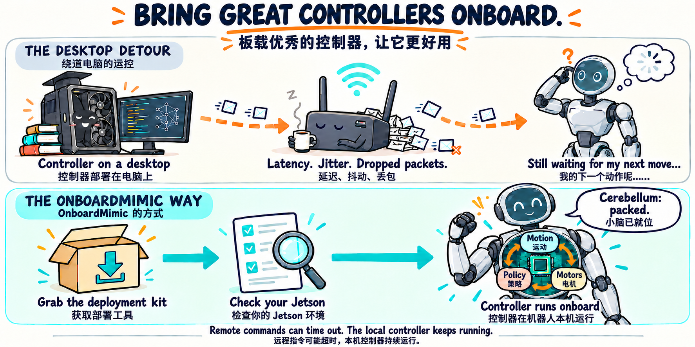
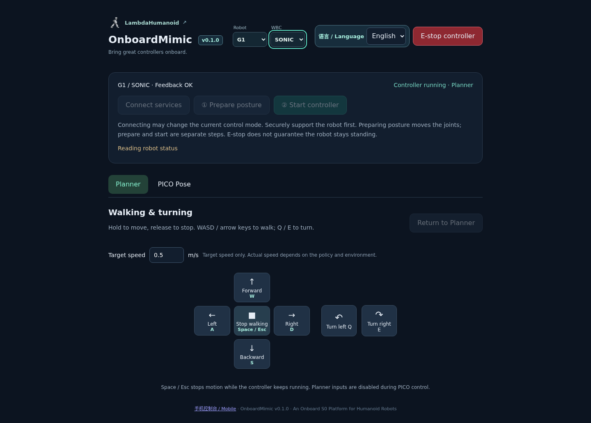

> **v1.1 development:** JetPack 6 source-build testing is on this branch. See the [JP6 guide](docs/JETPACK6.md). JP6 hardware acceptance is pending.
>
> **v1.1 开发分支：**正在测试 JP6 源码部署，详见 [JP6 指南](docs/JETPACK6.md)。尚待 JP6 实机验收。



# OnboardMimic

**Bring great controllers onboard.** · **板载优秀的控制器，让它更好用**

**An Onboard S0 Platform for Humanoid Robots / 人形机器人的板载 S0 平台**

> 🚀 **SONIC onboard today. SuperMimic is next on our roadmap.**
>
> **SONIC 已实现板载部署，下一站计划接入 SuperMimic。**

SONIC is our first onboard controller. Run it on your G1’s own Jetson: keep the robot’s cerebellum onboard, with JetPack 5 deployment tools, bilingual desktop/mobile consoles and PICO full-body teleoperation.

> SONIC 是首个板载控制器，目前支持 **Unitree G1**：让机器人的“小脑”运行在自身 Jetson 上，配套 JetPack 5 部署工具、中英文电脑/手机控制台与 PICO 全身遥操。

https://github.com/user-attachments/assets/6afc6f3e-d37e-4cd0-8d34-da85d1bc39bf

[🚀 Get started](#get-started) · [📦 Download v0.1.0](https://github.com/LambdaHumanoid/OnboardMimic/releases/tag/v0.1.0) · [🤝 Community](#community) · [🎮 Console](#consoles) · [🧩 Architecture](docs/ARCHITECTURE.md)

## 📰 News

- **v0.1.0 · First aboard: SONIC.** [Prebuilt packages](https://github.com/LambdaHumanoid/OnboardMimic/releases/tag/v0.1.0) for G1 / JetPack 5, with bilingual desktop/mobile consoles for **Planner walking** and optional **PICO Pose** teleoperation. [Setup and controls](docs/CONTROL_EXTENSIONS.md).

> **v0.1.0 · 首个板载控制器：SONIC。** 提供面向 G1 / JP5 的预编译安装包，配套中英文电脑和手机控制台，支持 **Planner 行走**与可选 **PICO Pose 全身遥操**。[安装与控制说明](docs/CONTROL_EXTENSIONS_zh.md)。

## 📝 TODO

- [ ] **Integrate SuperMimic as an onboard backend. / 接入 SuperMimic 板载后端。**
- [ ] Support motion recording and playback. / 支持动作录制和回放。
- [ ] Adapt SONIC’s low-latency and newer policy variants. / 适配 SONIC 的低延迟版本和更新策略。
- [ ] Bring more controllers and robot bodies onboard. / 适配更多控制器与机器人本体。

## 📡 Let your Wi-Fi take a coffee break

**Onboard deployment. Easier to use. Starting with SONIC.** OnboardMimic keeps the motion-control loop off Wi-Fi. We’re starting with SONIC on G1: adapting its planner and policy to the robot’s existing JetPack 5 system and bringing deployment tools, runtime management and control interfaces together. Your laptop gets to be a remote control. Your robot gets to do its own balancing.

Why does this matter? Official SONIC supports onboard deployment, but its [G1 Orin setup](https://nvlabs.github.io/GR00T-WholeBodyControl/getting_started/installation_deploy.html) requires **JetPack 6 and TensorRT 10.7**. For a G1 still on JP5, the [flashing guide](https://nvlabs.github.io/GR00T-WholeBodyControl/references/jetpack6.html) involves removing the back cover and NVMe SSD, flashing the system and module firmware, then reassembling the robot. You wanted to install software; now there is a screwdriver on the desk.

Running SONIC on an external GPU computer avoids that onboard setup, but puts network latency, jitter and dropped packets in the control path. Your robot has acquired a wireless leash.

With OnboardMimic’s SONIC backend, the control loop stays on the robot’s Jetson, using the supported JP5 configuration below. The laptop or phone sends commands; PICO sends body tracking. Remote commands and tracking still need a network, but the local motion-control loop no longer takes the round trip.

> **实现板载部署，更好用。先从 SONIC 开始。** OnboardMimic 将运控闭环留在机器人本机，不再绕经 Wi-Fi。我们先将 SONIC 的规划器和策略适配到 G1 现有的 JetPack 5 系统，并提供配套部署工具、运行管理和操控界面。电脑负责遥控，机器人负责自身平衡。
>
> 为什么需要这些工作？SONIC 官方支持板载部署，但其 [G1 Orin 部署指南](https://nvlabs.github.io/GR00T-WholeBodyControl/getting_started/installation_deploy.html)要求 **JetPack 6 和 TensorRT 10.7**。仍在使用 JP5 的 G1，按[刷机教程](https://nvlabs.github.io/GR00T-WholeBodyControl/references/jetpack6.html)需要拆背板、取出 NVMe SSD、刷系统和模块固件，再装回去。只是想装个运控，先拿起了螺丝刀。
>
> 放到外部 GPU 电脑上可以免去这套板载配置，但网络延迟、抖动和丢包会进入控制链路，给机器人拴上一根“无线牵引绳”。
>
> 使用下方支持的 JP5 配置，OnboardMimic 的 SONIC 后端让运控闭环留在机器人自身 Jetson 上。电脑和手机负责发指令，PICO 负责提供人体追踪；这些数据仍需网络传输，但本机运控闭环不再经过网络往返。

SONIC is our first onboard controller, with **SuperMimic planned as the next backend** and more controllers to follow. Robot adapters, controllers and input devices are separate modules to support those integrations. The algorithms and pretrained models remain the work of their original authors. [How the platform fits together →](docs/ARCHITECTURE.md)

> SONIC 是首个支持板载部署的控制器，**下一步计划接入 SuperMimic**，并陆续支持更多控制器。平台将本体、控制器和输入设备拆分，为持续接入做好准备；算法和模型归属原作者。[看看模块如何配合 →](docs/ARCHITECTURE_zh.md)

<a id="get-started"></a>

## 🚀 Get started / 开始使用

| Component / 组件 | Current SONIC profile / 当前 SONIC 配置 |
| --- | --- |
| Robot / 机器人 | Unitree G1, 29-DOF body, no hand control / 29 自由度本体，不含手部控制 |
| Computer / 机载计算机 | Jetson Orin NX **16 GB** |
| System / 系统 | JetPack 5 · Ubuntu 20.04 · L4T **35.3.1** |
| GPU software / GPU 软件 | CUDA **11.4** · TensorRT **8.5.2** |

**Start with your coding agent:** give it this repository and ask it to check your hardware/software versions, download the v0.1.0 packages, follow the installation guide, configure communication, and open the console. For manual setup:

1. Download the three archives and checksums from [v0.1.0](https://github.com/LambdaHumanoid/OnboardMimic/releases/tag/v0.1.0), then follow the [package guide](docs/PREBUILT.md) to verify and extract them.
2. Run **`python3 scripts/setup.py`** in `OnboardMimic/`. The wizard installs dependencies, checks inference, configures communication and opens the idle console. Choose LAN access for phones; PICO is optional.
3. Open the console: **Connect services → Prepare posture → Start controller.** Installing or opening the page does not start SONIC.

> **直接把仓库交给你的 coding agent。** 让它先核对软硬件版本，再下载 v0.1.0 安装包，按指南完成安装、通信配置和控制台启动。手动安装：
>
> 1. 从 [v0.1.0](https://github.com/LambdaHumanoid/OnboardMimic/releases/tag/v0.1.0) 下载三个压缩包和校验值，按[预编译安装指南](docs/PREBUILT_zh.md)校验并解压。
> 2. 在 `OnboardMimic/` 中运行 **`python3 scripts/setup.py`**。向导安装依赖、检查推理、配置通信并启动空闲控制台；手机访问选择 LAN，PICO 可选。
> 3. 打开控制台，手动执行 **连接服务 → 准备姿态 → 启动控制器**。安装或打开页面不会启动 SONIC。


The release has completed the full deployment workflow on a physical G1, including inference checks, console access, reboot readiness and operator motion acceptance. [Validation scope](docs/VALIDATION.md). Other robot bodies and environments require separate adaptation. For custom builds, use the [source guide](docs/SOURCE_BUILD.md).

> 已在 G1 真机上完成全流程部署验证，包括推理检查、控制台访问、开机就绪和现场运动验收。[验证范围](docs/VALIDATION.md)。其他本体与环境需要单独适配；定制构建见[源码指南](docs/SOURCE_BUILD_zh.md)。

<a id="community"></a>

## 🤝 Community validation / 社区共建

Our current adaptation and real-robot validation cover the mainstream G1 EDU factory configuration listed above: **JetPack 5.1.1 / L4T 35.3.1**. If your G1 EDU runs a different JetPack or L4T version, we welcome your help adapting and validating OnboardMimic on your own robot.

Share your hardware/software versions, any required changes, and test results through an [Issue](https://github.com/LambdaHumanoid/OnboardMimic/issues) or [Pull Request](https://github.com/LambdaHumanoid/OnboardMimic/pulls), using the [validation scope](docs/VALIDATION.md) as a reference. After successful real-robot validation and review of the results, we can add your configuration to the **verified configurations list**, recording the exact versions, tested features and contributor credit.

> 目前我们仅适配并完成了上述主流 G1 EDU 原厂配置的真机验证：**JetPack 5.1.1 / L4T 35.3.1**。如果你的 G1 EDU 使用其他 JetPack 或 L4T 版本，欢迎在自己的真机上参与适配与验证，一起扩大项目的支持范围。
>
> 欢迎通过 [Issue](https://github.com/LambdaHumanoid/OnboardMimic/issues) 或 [Pull Request](https://github.com/LambdaHumanoid/OnboardMimic/pulls) 分享软硬件版本、必要的适配修改和测试结果，并参考现有的[验证范围](docs/VALIDATION.md)。真机验证通过并确认结果后，我们可以将该配置加入**已验证版本列表**，注明具体版本、已验证功能与贡献者。

<a id="consoles"></a>

## 🎮 Desktop & mobile consoles / 电脑与手机控制台



*English UI, captured with a mock backend. Switch languages using **语言 / Language**. / 英文界面，使用模拟后端截图。通过 **语言 / Language** 切换中英文。*

- **Planner:** WASD / arrow keys to walk, Q / E to turn. Hold to move, release to stop; adjust the target speed on the page.
- **Mobile:** landscape dual joysticks—walk on the left, turn on the right. [Phone/LAN setup](docs/CONTROL_EXTENSIONS.md#lan-access).
- **PICO Pose:** preview body tracking, then explicitly switch into full-body teleoperation. [Headset setup](docs/CONTROL_EXTENSIONS.md#pico-setup).

> - **Planner：** WASD / 方向键行走，Q / E 转向；按住移动，松开停止，目标速度在页面调节。
> - **手机：** 横屏双摇杆，左走右转。[手机与局域网配置](docs/CONTROL_EXTENSIONS_zh.md#lan-access)。
> - **PICO Pose：** 先预览人体追踪，再手动切入全身遥操。[头显配置](docs/CONTROL_EXTENSIONS_zh.md#pico-setup)。

### Open the console / 打开控制台

After setup, the console and API are ready at boot. Connect services, prepare posture and start the controller manually. With LAN access configured, open **`http://ROBOT_IP:8769/`** on your laptop or **`http://ROBOT_IP:8769/remote`** on your phone. Local-only access uses an SSH tunnel on your laptop:

> 完成配置后，控制台和后台开机就绪；连接服务、准备姿态和启动控制器均由用户手动操作。配置 LAN 访问后，电脑打开 **`http://ROBOT_IP:8769/`**，手机打开 **`http://ROBOT_IP:8769/remote`**；仅本机访问时在电脑使用 SSH 隧道。

```bash
ssh -N -L 8769:127.0.0.1:8769 USER@ROBOT_HOST
```

Keep the tunnel open and visit **http://127.0.0.1:8769/**. / 保持隧道运行，在电脑浏览器打开上述地址。

Remote walking requests expire when updates stop; the local controller keeps running. Emergency stop terminates the controller. Neither behavior guarantees the robot remains standing. / 遥控断连后行走请求会到期，本机控制器继续运行；急停会终止控制器。这两种机制都不保证机器人保持站立。

## 📚 Documentation / 文档

[Prebuilt packages](docs/PREBUILT.md) · [Source build](docs/SOURCE_BUILD.md) · [Deployment](docs/DEPLOYMENT.md) · [Planner & PICO](docs/CONTROL_EXTENSIONS.md) · [Upgrade](docs/UPGRADE.md) · [Architecture](docs/ARCHITECTURE.md) · [Validation](docs/VALIDATION.md)

[预编译安装](docs/PREBUILT_zh.md) · [源码构建](docs/SOURCE_BUILD_zh.md) · [首次部署](docs/DEPLOYMENT_zh.md) · [Planner 与 PICO](docs/CONTROL_EXTENSIONS_zh.md) · [升级与回退](docs/UPGRADE_zh.md) · [架构说明](docs/ARCHITECTURE_zh.md) · [验证范围](docs/VALIDATION.md)

## 🙏 Acknowledgements / 致谢

Built on [NVIDIA GEAR SONIC / GR00T-WholeBodyControl](https://github.com/NVlabs/GR00T-WholeBodyControl). The core controller and pretrained models belong to their original authors. Our work focuses on JP5 adaptation, onboard integration, deployment tools and control interfaces. This is a community project, not an official NVIDIA or Unitree release.

> 本项目基于 [NVIDIA GEAR SONIC / GR00T-WholeBodyControl](https://github.com/NVlabs/GR00T-WholeBodyControl)，核心控制器与预训练模型归属原作者。我们的工作集中在 JP5 适配、板载集成、部署工具和操控界面。这是社区项目，并非 NVIDIA 或宇树官方发行版。

[Project scope and provenance](docs/PROJECT.md) · [Apache-2.0 source license](LICENSE) · [Citation](CITATION.cff). Model weights and dependencies retain their own terms.

> [项目范围与来源](docs/PROJECT.md) · [Apache-2.0 源码许可证](LICENSE) · [引用信息](CITATION.cff)。模型权重和依赖仍遵循各自的条款。

## ✍️ Authors / 作者

**By [LambdaHumanoid](https://github.com/LambdaHumanoid) · [Yiming Jiang](https://iridescentjiang.github.io/) · [Yilun Chen](https://yilunchen.com/about/)\* · [codex](https://openai.com/codex/)**

\* Project Leader

Questions, feedback, or a deployment story? Reach Yiming Jiang at [jiangyimingjym@buaa.edu.cn](mailto:jiangyimingjym@buaa.edu.cn).

> 有问题、建议，或想分享部署经历？通过 [jiangyimingjym@buaa.edu.cn](mailto:jiangyimingjym@buaa.edu.cn) 联系 Yiming Jiang。
